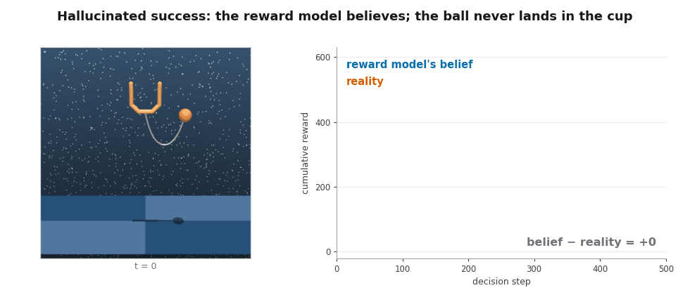
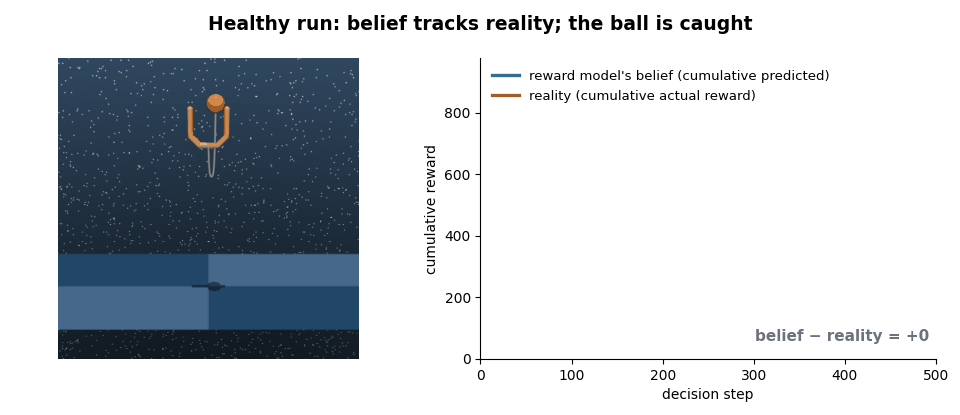

# Dreamer V4 — PyTorch reproduction

[](https://arxiv.org/abs/2509.24527)
[](LICENSE)

A PyTorch implementation of **Dreamer 4** (Hafner, Yan & Lillicrap, 2025, [arXiv:2509.24527](https://arxiv.org/abs/2509.24527)), the agent that improves a cloned policy by practicing inside a learned world model. All three phases run end to end on one GPU: a masked autoencoder tokenizer, a block causal transformer world model trained with shortcut forcing, a Phase 2 finetune that adds reward, continue and behavior cloning (BC) heads, and Phase 3 imagination training with PMPO. Every policy is scored closed loop in the real `dm_control` environment.

I used this implementation to test Dreamer 4's claim that imagination training improves on the BC policy it starts from, on one task (`ball_in_cup_catch`) with a fixed dataset of 240 demonstrations. The paper on this study is under review. The review is double blind, so I do not name the venue here, and the code of the submitted version is tagged `tmlr-submitted`.

## Result

With one world model and a fixed dataset, I repeated the Phase 2 training 8 times with different seeds and trained 3 imagination policies from each retrain. Every policy played the same 500 games in the real environment, so each imagination policy is compared with its own BC parent on identical games.

| Phase 2 retrain | BC parent catch (%) | imagination catch (%), mean of 3 seeds | gain per seed (points) | retrain mean (points) |
|:---:|:---:|:---:|:---:|:---:|
| 10 | 55.8 | 71.0 | +13.0, +14.4, +18.2 | +15.2 |
| 11 | 53.8 | 87.3 | +35.2, +32.2, +33.2 | +33.5 |
| 12 | 51.2 | 79.1 | +27.8, +29.2, +26.8 | +27.9 |
| 13 | 54.4 | 87.7 | +36.2, +30.6, +33.2 | +33.3 |
| 14 | 56.4 | 82.5 | +29.0, +24.4, +24.8 | +26.1 |
| 15 | 54.6 | 83.7 | +31.0, +24.2, +32.2 | +29.1 |
| 16 | 53.6 | 82.3 | +29.4, +25.0, +31.8 | +28.7 |
| 17 | 56.6 | 79.9 | +21.2, +23.0, +25.6 | +23.3 |
| **mean over retrains** | 54.55 | 81.70 | 24/24 runs positive | **27.15** [22.20, 32.10] |

The imagination policy beat its BC parent in all 24 runs. Averaged over the 8 retrains, the catch rate rose by **27.15 percentage points** (95% t interval over the retrain means 22.20 to 32.10). The spread between retrains (5.70 points) was about twice the spread between imagination seeds of one retrain (2.76 points), so the Phase 2 retrain is the unit of variation worth reporting.

The BC parents caught the ball in 54.55% of games, against 84.2% for the demonstrations. So the claim this evidence supports is that imagination training improves on a weak BC start. Whether it improves on a strong one is untested here.

Per game results of all 32 policies are in `evaluation/tmlr-aligned-*/episodes.csv`. `analysis/paper_numbers_v2.py` and `analysis/paper_tables_v2.py` are the scripts behind every number and table in the paper; their header says which inputs they read.

## Two silent defects, and the checks that catch them

My first version of this pipeline had two defects that passed all 12 checks I used to verify it.

1. **Every action reached the model one step late.** The dataset stores, with each frame, the action that led to it; my loader read it as the action taken at that frame. Both the world model and the BC target were affected. The standard action shuffle check passed, because it only shows that a model uses its actions, and a model trained on late actions uses them too.
2. **The bootstrap loss received almost no learning signal.** Keeping frame 0 almost clean while its step size was drawn at random produced an enormous artifact term, and a separate normalizer for the bootstrap loss then divided the real signal by the artifact's size. The old world model's error at the shortcut steps was 76 to 109 times its error at the smallest step.

With both defects present, the same evaluation gave a convincing gain on the first Phase 2 model (+5.9 points, all 6 runs positive) and then gains and losses on further retrains (-32.6, +24.2 and -8.3 points). One retrain was not enough to judge the gain.

Three checks that need no further training catch these failures. They are in `analysis/`:

- **Timing test** (`analysis/phase1_timing_control.py`): feed the trained model the same clips with the actions shifted in time and see which shift predicts best. Every old model preferred late actions; every corrected model preferred correct timing. It took 14 minutes for 9 models on a laptop GPU.
- **Step size test** (`dynamics/evaluate_dynamics.py`): break the prediction error down by step size and by the signal level of the input. The defective world model's error rose as the input got cleaner; the corrected model's fell.
- **Reward calibration** (`dynamics/evaluate_env.py`): let the reward head predict rewards while the policy plays real games, and compare with what the environment paid. The one exploitation case I observed came from the defective pipeline's collapsed retrain:

<p align="center">
  <br>
  <br>
  <em>Two retrains of the defective pipeline. Top, the collapsed retrain: the frozen reward head keeps predicting reward on a game where the ball never lands in the cup. Bottom, a healthy retrain: predicted reward tracks the real one. Left is the real episode, right the cumulative predicted versus real reward.</em>
</p>

## History of this README

Earlier versions of this README reported results from the defective pipeline: a six run study with a +5.9 point gain, three Phase 2 retrains whose gains ranged from −32.6 to +24.2 points, and before that a single run with no significant gain. Those numbers were produced by the defective code and are superseded by the table above. They stay in the git history (tag `v1-old-pipeline`) because the story of how they were wrong is part of the paper.

## Reproduce

Each step needs the output of the one before it. The launch scripts under `launch/` are the commands that produced the paper's runs; the `cd /workspace/dreamer_v4` and checkpoint paths at their top are my pod layout, so set them to yours.

```bash
pip install -r requirements.txt
pip install dm_control mujoco          # closed loop evaluation
export MUJOCO_GL=egl                   # headless rendering
```

1. **Dataset.** Download the `cup-catch` demonstrations (`expert`, `mixed-small`, `mixed-large`) from [nicklashansen/dreamer4](https://github.com/nicklashansen/dreamer4) into `hansen_data/`, then
   `python convert_hansen_to_npz.py --hansen-root hansen_data --out-path ball_in_cup_catch_aligned.npz`.
   The script shifts the stored actions one row earlier per episode (the fix of defect 1). The data are not redistributed here.
2. **Tokenizer.** `python -m tokenizer.train_tokenizer --dataset offline --dataset-path ball_in_cup_catch_aligned.npz --image-size 128 ...` with the settings in the paper's hyperparameter table (`--help` lists every flag).
3. **Phase 1, world model.** `bash launch/phase1.sh` after pointing `--tokenizer-ckpt` and `--dataset-path` at your files.
4. **Phase 2, heads and BC policy**, one retrain per seed. Set `BASE`, `TOK` and `NPZ` at the top of `launch/phase2.sh`, then `SEEDS="10 11 12 13 14 15 16 17" bash launch/phase2.sh`.
5. **Phase 3, imagination training and evaluation**, one job per (retrain, seed): `JOBS="10:1 10:2 10:3" bash launch/phase3.sh`, and so on for retrains 11 to 17.
6. **Evaluation on its own**, as recorded under `opts` in every `evaluation/*/summary.json`:
   ```bash
   python -m dynamics.evaluate_env --phase2-ckpt <phase2.pt> --phase3-ckpt <phase3.pt> --tokenizer-ckpt <tokenizer.pt> \
     --num-episodes 500 --seed-base 0 --image-size 128 --action-repeat 2 --policies phase3 --output-dir evaluation/<name>
   ```
   (`--policies bc` for a BC parent.) It writes `episodes.csv` with one row per game.
7. **Unit tests** of the RL math: `python -m tests.test_imagination_algorithms`, `python -m tests.test_imagination_rollout`, `python -m tests.test_gradient_isolation`.

### Checkpoints

The checkpoints on the Hugging Face Hub at [`vijayabhaskarev/dreamer-v4`](https://huggingface.co/vijayabhaskarev/dreamer-v4) are the **defective pipeline's** and are kept for the record. The corrected pipeline's checkpoints (tokenizer, world model, the 8 Phase 2 retrains and the 24 imagination policies) will be uploaded after the review.

## Repository layout

```
dreamer_v4/
├── tokenizer/         masked autoencoder tokenizer (model, masking, losses, trainer)
├── dynamics/          world model with shortcut forcing, Phase 2 finetune, real environment evaluation
│   ├── dynamic_model.py      transformer with register and agent tokens
│   ├── flow_matching.py      noise schedule and (signal level, step size) sampling
│   ├── trainer.py            the shortcut loss as one normalized term (defect 2 fix)
│   ├── evaluate_dynamics.py  error by step size and signal level (the step size test)
│   └── evaluate_env.py       closed loop evaluation, paired games, reward calibration
├── imagination/       Phase 3: imagined rollouts, lambda returns, PMPO, trainer
├── heads.py           reward, continue, value and policy heads (categorical and Gaussian)
├── analysis/          the timing test and the scripts behind every number and table of the paper
├── launch/            the launch scripts of the three phases
├── evaluation/        per game results of every evaluated policy
├── convert_hansen_to_npz.py   builds the dataset file (defect 1 fix lives here)
├── tests/             unit tests of the imagination algebra, the rollout contract and the attention firewall
└── requirements.txt
```

## Limitations

- One task, one dataset, one tokenizer and one Phase 1 world model. Whether the gain holds elsewhere is untested.
- The BC parents were weak compared with the demonstrations, partly because the BC head was trained on every episode, including those that never catch. The result covers a weak BC start.
- The two fixes and a fresh Phase 1 training run entered together, so the change between the two pipelines cannot be attributed to either fix alone.
- Two silent defects passed 12 checks, so a third one that these checks would also miss cannot be ruled out.
- Single GPU CUDA only; no distributed training.

## References

- Hafner, Yan, Lillicrap. *Training Agents Inside of Scalable World Models* (Dreamer 4). [arXiv:2509.24527](https://arxiv.org/abs/2509.24527), 2025.
- Hansen, Su, Wang. *TD-MPC2: Scalable, Robust World Models for Continuous Control*. ICLR 2024. The demonstrations were collected with TD-MPC2 agents and released at [nicklashansen/dreamer4](https://github.com/nicklashansen/dreamer4).
- Abdolmaleki et al. *Learning from Negative Feedback, or Positive Feedback or Both* (PMPO). ICLR 2025. The policy objective used in Phase 3.

## Citation

Please cite the Dreamer 4 paper for the method. For this implementation:

```bibtex
@software{eswaran2026dreamerv4,
  title  = {Dreamer V4 --- PyTorch reproduction},
  author = {Eswaran, Vijaya Bhaskar},
  year   = {2026},
  url    = {https://github.com/vijayabhaskar-ev/dreamer_v4}
}
```

A citation for the paper will be added once the review is complete.

## License

MIT, see [`LICENSE`](LICENSE).
